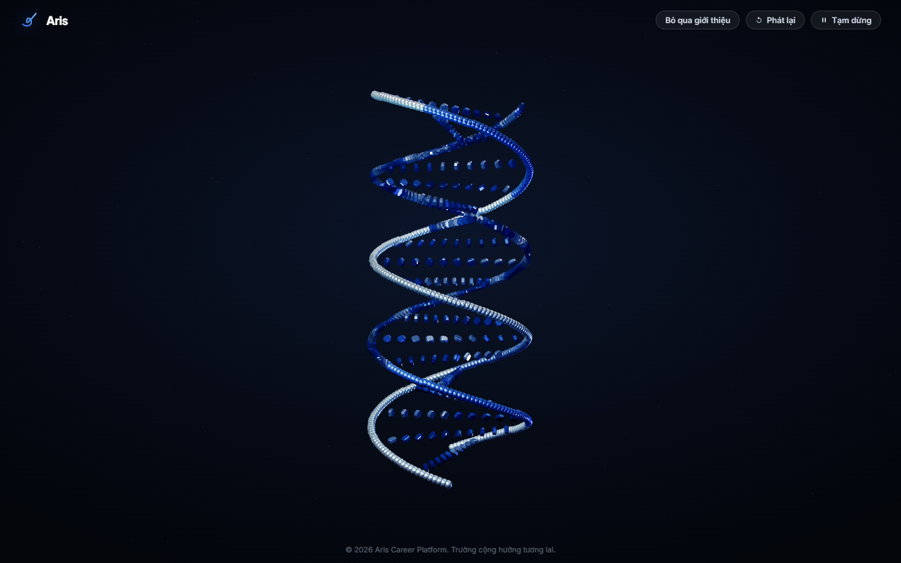
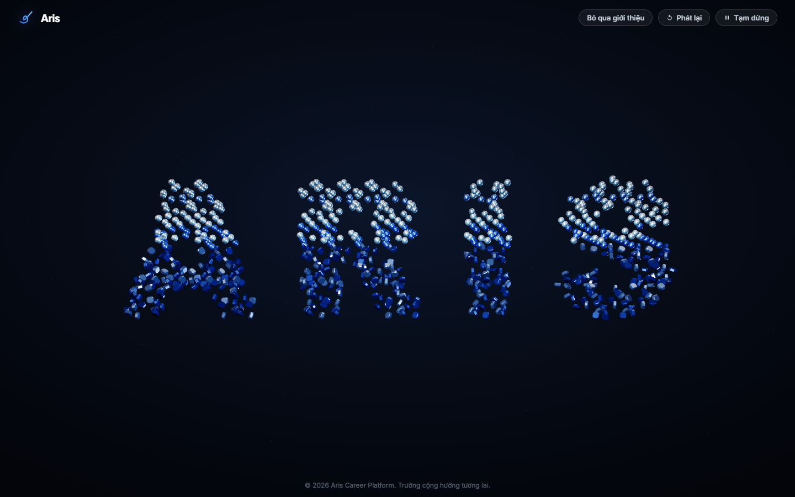
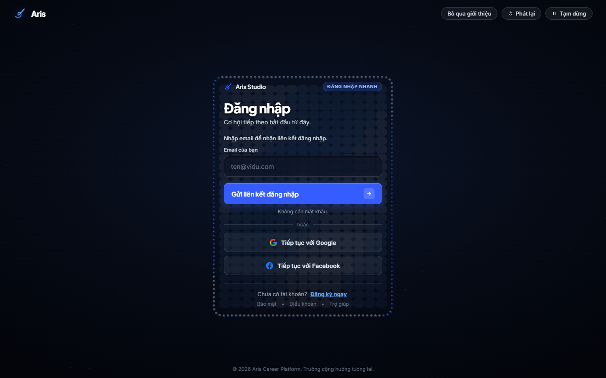
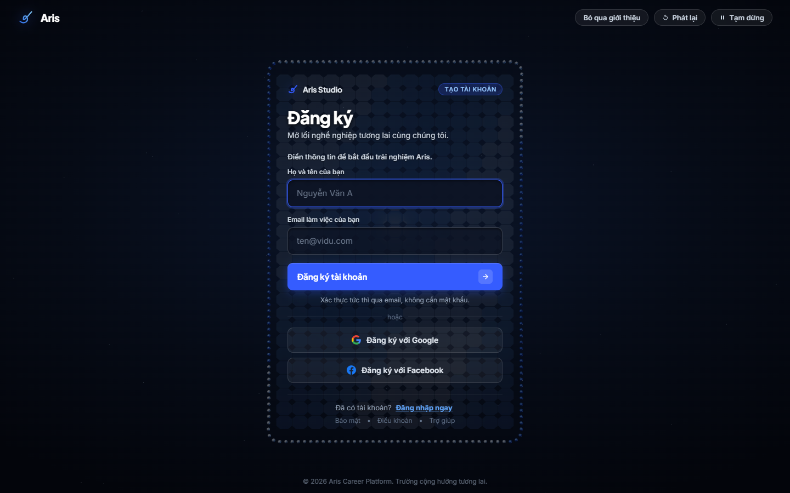
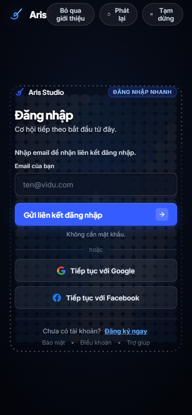

# Đánh giá trực tiếp login V5 — baseline cần giữ

Người dùng chỉ định: `D:\Downloads\ArisThucTap-main\ArisThucTap-main\docs\design-lab\aris-login-v5`.

**Kết luận thiết kế:** V5 có composition và choreography hấp dẫn hơn study login phẳng đã đề xuất. Giữ bản này làm nền và nâng card cuối; không thay bằng split layout hay nền SVG quay. Đây là đánh giá thẩm mỹ từ lần chạy và các frame quan sát, không phải kết luận mọi phần của V5 đã hoàn thiện.

## Đã xem và thử

Mở chính `index.html` trong Chrome qua file URL, không sửa source, không submit form. Chụp DNA, ARIS, final login, Register, quay lại Login, focus email; lưu clip browser. Kiểm tra mobile 390×844 ở reduced motion. Lần chụp cuối dùng `?clean=true` để ẩn thanh debug.

- Desktop 1440×900: Register hiện được, quay lại Login hiện được; document width 1440.
- Mobile reduced motion: document width 390; đây là kiểm tra final layout, không phải kiểm tra full intro trên mobile.
- Không ghi nhận page exception trong lượt chạy này. Chưa đo FPS/GPU hoặc thử email/OAuth/backend.
- Video lưu trong `evidence/v5-reference-review/video/`; kết luận trực quan dựa trên các frame và tương tác đã xem, không tuyên bố đã xem lại toàn bộ clip bằng trình phát.

## Vì sao V5 tốt hơn hướng đã đề xuất

| Quan sát | Giá trị cần giữ |
|---|---|
| DNA có sợi trước/sau, khoảng trống và highlight trắng/xanh | Cảm giác vật thể thực trong không gian, có trọng tâm rõ |
| Vật liệu đi từ DNA thành chữ ARIS | Chuyển động kể một câu chuyện nhận diện, không chỉ trang trí nền |
| Chữ và material chuyển thành card ở trung tâm | Form thuộc cùng trải nghiệm, không bị tách thành sản phẩm khác |
| Nền tối rộng, chrome nhỏ, scene là điểm chính | Tỷ lệ sân khấu giúp motion có sức nặng và làm người xem tập trung |
| Login/Register có morph và dùng cùng scene | Nhất quán giữa hai mode, đáng phát triển tiếp |

## Card cần nâng ở đâu

1. **Bề mặt còn giống lát ô:** ở ready-state nhìn rõ lưới facet và khoảng trống giữa các ô. Cần một mặt đọc liền hơn bằng geometry/material/target distribution; texture chuyển xuống mức tinh tế.
2. **Viền là chuỗi chấm:** rim đọc như hạt trang trí bao quanh; cải thiện thành cạnh có độ dày và highlight mảnh, vẫn thấy xuất xứ nano khi morph.
3. **Nội dung dày ở đầu card:** brand, mode pill, heading, subtitle, instruction đều đòi chú ý trước email. Bớt câu lặp và hạ hierarchy của metadata; cho heading/form khoảng thở.
4. **Register kéo dài nhưng nhịp chưa đổi:** name/email/social/footer cần grouping rõ; morph height giữ điểm neo và không dồn tất cả thành một cột đều nhau.
5. **Input/CTA/social đang giống các thanh ngang:** tạo phân cấp vật liệu/contrast rõ hơn: input inset yên tĩnh, CTA có một accent chính, social nhẹ hơn. Không thêm glow cho mọi control.
6. **Mobile:** header controls Skip/Replay/Pause khá dày và wrap nhiều dòng; thu gọn nhãn/đưa Replay vào nhóm phụ nhưng giữ Skip/Pause dễ tiếp cận. Card phải cuộn tự nhiên, chữ/input không bị scale nhỏ.

## Ảnh mới để AGY đối chiếu

## So với auth source hiện tại

Trong lần đọc mới, `_AuthLayout.cshtml` dùng `.auth-orbit-svg`, `orbitSpin`, `starPulse`, card `.auth-glass-card` và panel `.auth-showcase-desktop`. Không thấy scene Three.js/WebGL V5 được gắn trong layout này. Đây là đối chiếu source; không khẳng định bản executable localhost đã rebuild đúng revision đó.

Vì vậy kế hoạch phải yêu cầu **đưa trải nghiệm V5 vào route auth thật**. Việc đổi nền tối, font và viền của form hiện có chưa đáp ứng yêu cầu 3D/motion người dùng đang nói tới.

## Chỉ dẫn chốt cho AGY

Lấy V5 làm baseline về composition và motion. Sửa ready-card cho đẹp hơn, rồi tích hợp backend. Dùng screenshot cùng viewport và clip DNA → ARIS → Login → Register → Login để chứng minh tiến bộ. Không copy study `preview.html`. Dashboard học cùng màu, vật liệu, chiều sâu và ngôn ngữ chuyển động; giữ feed và hành động nghề nghiệp làm trọng tâm.
